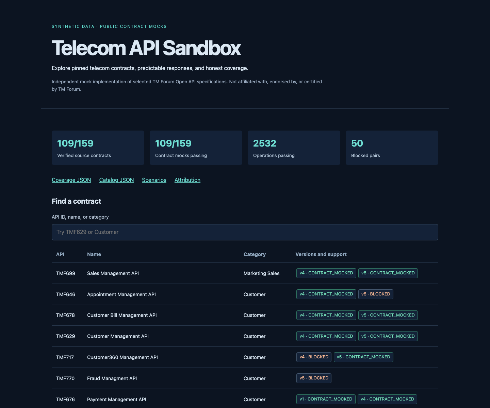

# Telecom API Sandbox

A local telecom API sandbox for integration tests, agent tools, and support demos. It compiles real TM Forum OpenAPI contracts into deterministic responses served by one Cloudflare Worker.

**Early preview · v0.1.0** — Independent implementation. Not affiliated with, endorsed by, or certified by TM Forum.



## Current coverage

The pinned inventory is the directory snapshot from **2026-10-22**.

| Measure | Current snapshot |
| --- | ---: |
| Directory inventory | 104 APIs / 159 major-version pairs |
| Verified, licensed, contract-mocked pairs | 109 / 159 |
| Passing HTTP operations | 2,532 |
| Schema-validated response bodies | 1,863 |
| Bodyless responses checked for status semantics | 669 |
| Seeded API/version projections | 14 |
| Blocked source pairs | 50 |

Every locked contract must pass verification. The [source gaps](catalog/source-gaps.json) explain missing contracts and license issues. A directory listing alone is not implemented support. Contract mocks do not imply TM Forum certification or complete business behavior.

## Quick start

Use **npm** and the Node version in [.node-version](.node-version).

```sh
npm ci
npm run build
npm run dev
```

Open **http://localhost:8787/docs/** to browse contracts and send example requests.

```sh
curl http://localhost:8787/tmf-api/customer/v5/customer/customer-001
```

The seeded customer response includes:

```json
{
  "@type": "Customer",
  "id": "customer-001",
  "name": "Example Fiber Household"
}
```

The full response links to the fictional party record. Follow `/scenarios/support-fiber-outage` to explore the customer, product, service, resource, ticket, and restoration order. Original [retrieval documents](scenarios/support-fiber-outage/documents/outage-playbook.md) provide synthetic outage facts for RAG demos.

Wrangler requires a supported OS. On older systems, use `npm run dev:node` for the Node preview of the same Hono Fetch handler. See [testing](docs/testing.md) for the actual workerd runtime check.

## What to expect

- Public POST, PATCH, PUT, and DELETE return **fixed mock responses**. They persist no changes and trigger no provisioning or notifications.
- Generic detail routes return examples for arbitrary IDs. Seeded detail routes recognize their published IDs and return 404 for unknown records.
- Missing v5 context paths use reviewed v4 paths with the version changed to v5, or explicit project conventions where v4 is unavailable. For example, the TMF638 hub is `/tmf-api/serviceInventory/v5/hub`. [Routing overrides](catalog/context-path-overrides.json) and generated specs identify the changes. Every effective method/path must be unique; duplicates fail the build.
- Query support is limited to declared `offset` and `limit` pagination. Unsupported query behavior returns 400.
- Swagger 2 and OpenAPI 3.0 are compiled offline. OpenAPI 3.1, unpinned external references, unsupported response media, and unresolved schema problems are explicit exceptions.
- Optional relationships that fail strict schema validation are omitted from seeded projections with notes. Private writable sandboxes are a future phase.

Use `/catalog`, `/catalog/TMF629/v5`, `/coverage`, and `/scenarios` for machine-readable metadata. [Source locks](catalog/spec-lock.json) retain exact upstream versions, commits, hashes, licenses, and edition-selection rationale.

## Verify a change

```sh
npm run lint
npm run typecheck
npm test
npm run verify:runtime
```

Build before these commands on a clean checkout. The runtime command starts local Wrangler, tests every generated operation and the docs endpoints over HTTP, measures the bundle with a dry run, and stops the server. It does not deploy.

GitHub Actions runs this pipeline on Linux and uploads coverage reports and generated assets. Reports identify the source revision, content fingerprint, and pinned-source hash. Production CPU time remains unmeasured until an authorized Cloudflare test deployment.

## Project documentation

- [Architecture and runtime behavior](docs/architecture.md)
- [Architecture decision records](docs/adr/README.md)
- [Roadmap and remaining work](docs/roadmap.md)
- [Original design proposal (historical)](docs/design/original-proposal.md)
- [Source acquisition and licensing](docs/sources.md)
- [Testing and baseline updates](docs/testing.md)
- [Maintainer release checklist](docs/maintaining.md)
- [Contributing](CONTRIBUTING.md) · [Security](SECURITY.md) · [Changelog](CHANGELOG.md)

Project code is [MIT licensed](LICENSE). Upstream specifications and derived artifacts retain their applicable licenses and [attribution](NOTICE). Original upstream bytes are checked in; deployment output, caches, and the original handoff archive are excluded from the public source tree.
