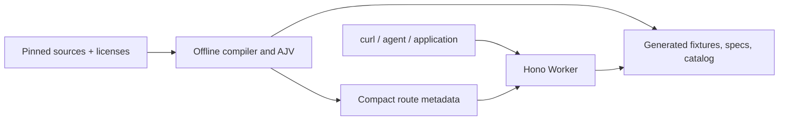

# Architecture

One TypeScript Cloudflare Worker uses Hono to route requests to precompiled fixtures through Workers Static Assets. OpenAPI parsing, conversion, sampling, and schema validation run during the build. Public requests perform no database queries, upstream API calls, random generation, or schema compilation.

This document describes the current implementation. The [original proposal](design/original-proposal.md) preserves the initial rationale and acceptance criteria; the [roadmap](roadmap.md) tracks remaining work.

The [architecture decision records](adr/README.md) document the choices and tradeoffs behind the implementation. Review them when changing architecture or policy.

## Source and output boundaries

| Directory | Purpose | Version controlled |
| --- | --- | --- |
| `catalog/` | Target inventory, source locks, selections, gaps, regression baseline | Yes |
| `upstream/` | Original, licensed, immutable upstream files and notices | Yes |
| `apps/api-worker/` | Request routing and immutable response handling | Yes |
| `apps/docs-web/public/` | Static explorer source | Yes |
| `scenarios/` | Original synthetic graph and retrieval documents | Yes |
| `tools/`, `tests/` | Offline tooling and verification | Yes |
| `generated/`, `public/`, `dist/` | Reports, compiled metadata, deployment assets, bundle | No |

`build:prepare` copies the checked-in web sources into an empty output tree. The compiler and scenario builder then generate the routing metadata required by the Worker. This makes a clean clone buildable without previously generated files.

## Routing and responses

The compiler derives URL prefixes from source servers/basePath and operation overrides. Where v5 omits the context, reviewed [context overrides](../catalog/context-path-overrides.json) supply the verified in-scope v4 context with its version changed, or an explicitly labeled project convention when an in-scope v4 source is unavailable. TMF638 uses the project convention `/tmf-api/serviceInventory/v5`; its v4 contract is outside scope and is not acquired. Generated specs expose the effective server and its derivation. Original source bytes remain unchanged. See [ADR 0004](adr/0004-routing-and-context-paths.md).

Literal segments take priority over variables. Each effective method/path must identify exactly one operation. Duplicate routes fail the build and require an explicit source or context correction; there is no runtime contract selector.

Each operation chooses a declared successful status and supported media type. Examples are used when valid; deterministic schema sampling supplies other fixtures. AJV checks response bodies when schemas exist. Bodyless responses are counted separately. All declared operations are enumerated again from the pinned sources during integration verification.

Mutations return immutable examples. There is no shared mutable public dataset, webhook delivery, or domain-state simulation. Generic detail IDs select an example; seeded detail IDs select the named scenario record.

## Synthetic scenario

The fiber-outage graph links a party, customer, offering, product, service, access resource, trouble ticket, and restoration order. Each available API major gets its own validated projection. Broken links prevent that projection from being published as seeded data.

`PUBLIC_ORIGIN` sets the trusted origin embedded in links at build time; its default is `http://localhost:8787`. The request Host header does not modify those links. An authorized deployment must rebuild using its actual origin.

TMF777 has no verified source in this snapshot. Outage facts come from the original retrieval documents; no TMF777 endpoint is fabricated.

## Hosting

The configuration uses one Worker and static assets, with no required D1 database or paid dependency. Reports measure asset and module sizes against the documented [Workers limits](https://developers.cloudflare.com/workers/platform/limits/). Local wall-clock measurements are not Cloudflare CPU measurements. Deployment and production CPU acceptance require explicit maintainer authorization.
